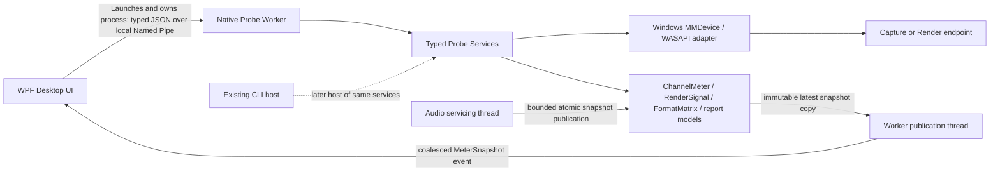

# D1 — Desktop UI / Native Worker architecture

**Status: ACCEPTED — ARCHITECTURE A — OWNER APPROVED 2026-10-30**
**D0:** GUI Design Kit v0.1 approved 2026-10-30.
**D2:** fake-data WPF shell implemented. **D3-A1:** fake-only native worker and typed local Named Pipe boundary implemented. **D3-B1:** explicit passive MMDevice endpoint discovery implemented; no audio client or stream operation is part of discovery. See [D2 implementation](D2_IMPLEMENTATION.md), [D3-A1 implementation](D3_A1_IMPLEMENTATION.md), and [D3-B1 implementation](D3_B1_IMPLEMENTATION.md).

## Code review: what exists

Review scope: `src/probe/wasapi_endpoint_probe.cpp`, `src/probe/channel_meter.h`, `src/probe/render_signal.h`, `src/probe/exclusive_format_matrix.h`, `src/probe/render_channel_report.h`, and `CMakeLists.txt` at D1 base `cd4937f110abd11497f109b41f319fee6338e3a5`.

| Concern | Current implementation and reuse boundary |
|---|---|
| Startup and arguments | `wmain` parses all CLI modes, duplicate/invalid combinations, bounds and consent flags, then dispatches. It is an executable entry path, not a service API. |
| Endpoint discovery | `ListEndpoints`, `ProbeEndpoint`, and `ProbeById` enumerate/read MMDevice properties and print friendly names, state, formats and local endpoint IDs. Results are not returned as typed endpoint objects to a caller. |
| Exclusive format matrix | `ExclusiveFormatMatrix` in `src/probe/exclusive_format_matrix.h` owns format candidates, statuses and classification; its `Api` interface is a useful fake seam. `WasapiFormatMatrixApi` and `RunFormatMatrix` in the monolith activate clients, call support/Initialize, and format console/JSON output. Query vs Initialize-only states are already separate. |
| Capture meter | `ChannelMeter::Meter`, `Snapshot`, math and report model in `channel_meter.h` are OS-neutral and bounded. The WASAPI adapter configures/processes Capture packets in `TestInitialize`/`RunStream`; a separate display thread polls snapshots and prints them. |
| Render channel test | `RenderSignal::Generator` is OS-neutral, fixed-storage and fills interleaved PCM. `TestInitialize` performs endpoint/format/Initialize setup, while `RunStream` services events, starts/stops WASAPI and updates `RenderChannelReport`. |
| Session lifecycle/cancellation | `RunStream` combines event waits, watchdog, cancellation, stream servicing, evidence and console output. The single-stream path uses a console control handler/global cancellation flag; Duplex creates two `std::thread` workers and a stop event/coordinator. |
| Reports | C1, C2 and format-matrix report data/`ToJson` helpers live in headers and are usable as serialization logic, but report creation, destination-path handling and mode orchestration remain in the CLI. Sanitized reports omit endpoint IDs; local CLI output can display them. |
| COM/thread ownership | `wmain` initializes MTA COM for ordinary single-endpoint commands. Duplex workers each initialize/uninitialize MTA COM and create/release their enumerator on their own thread. A future worker must preserve apartment-local ownership and deterministic release. |
| Build | `CMakeLists.txt` builds `KlidanAudioProbe` directly from the single `wasapi_endpoint_probe.cpp` translation unit and links Windows libraries (`ole32`, `propsys`, `setupapi`, `uuid`, `avrt`, `bcrypt`). It also has a standalone WAV exporter and separate test executables. Probe headers are included into the CLI and tests; there is no Probe service library or worker target. |

Useful portable building blocks are therefore the meter/snapshot, signal generator, format-matrix domain/classifier, report models, and existing fake API seams. They are not a complete native service boundary. In particular, callers should not invoke `wmain`, `TestInitialize`, `RunStream`, `ProbeInitById`, or `RunFormatMatrix` as if they were reusable thread-safe APIs.

Presentation and device work are mixed: `wmain` validates and prints CLI errors; `ListEndpoints`, matrix routines, `TestInitialize`, `RunStream` and Duplex workers contain many `printf` calls; the same orchestration owns WASAPI calls and status mapping. The C1/C2 JSON helpers are a useful separation point, but their data is populated by this CLI path. A future extraction should introduce typed command/result services and inject an output sink or return values, not parse console text.

## Candidate comparison

| Criterion | A. Separate worker + Named Pipe | B. Native DLL + C ABI |
|---|---|---|
| Failure isolation | Worker crash/hang does not directly crash WPF; OS process teardown releases process-owned resources, though cleanup evidence may be unknown. | Native crash or blocked call can terminate/freeze the WPF process. A C ABI does not provide process isolation. |
| Cancellation/shutdown | Explicit Stop request, terminal acknowledgement, bounded wait and process escalation. IPC disconnect is observable. | Direct cancellation can be fast, but ABI calls, callback lifetime and a wedged thread cannot be safely killed independently. |
| Thread/COM ownership | Worker owns COM and WASAPI; dedicated MTA audio owner thread(s), IPC thread separate. | Must precisely define which managed/native threads initialize COM and own interfaces; callbacks cross a managed/native boundary. |
| Meter overhead | Copies a small immutable snapshot at 10–20 Hz; bounded and coalesced. No PCM transport. | Lowest copy overhead is possible, but only if the ABI offers safe snapshot copying; callbacks/shared memory add lifetime risks. |
| Packaging | Two versioned executables plus .NET app; more files and handshake/version policy. | Single app package is simpler, but native runtime and ABI compatibility still need deployment policy. |
| CLI compatibility | CLI remains a host over shared services; worker protocol is separate from human-readable output. | CLI and UI can call one library if a public C ABI is created; this is a larger ABI commitment. |
| Hardware-free testing | Protocol, state machine, UI and worker can use fake backends; process crash/disconnect can be injected. | Unit tests can fake the C ABI, but process failure isolation cannot be tested because UI and native code share the process. |
| Future KLIDAN integration | Share sanitized versioned data/report contracts; no runtime game dependency. | Same possible report boundary, but DLL reuse could encourage unwanted binary coupling. |

### Recommendation and tradeoffs

Recommend A. The extra process, framing and deployment files are deliberate costs. They buy a failure boundary around native WASAPI and let the WPF UI remain responsive when the worker exits or is terminated. The IPC stream is low-rate control/status traffic; the audio servicing path remains in native code. A's isolation is not absolute: a driver or kernel fault can still affect Windows, and force-terminating the worker cannot prove a successful `IAudioClient::Stop` or orderly release.

B is not selected as the recommendation because code review found no existing stable C ABI and identified an executable-oriented, console-heavy host. Revisit B only with evidence that IPC is a material constraint and a reviewed design for cancellation, COM apartments, callbacks, ABI versioning and failure containment.

Other rejected approaches: permanent stdout parsing; hosting audio APIs in the WPF process; an always-running daemon; restarting active tests after a disconnect; and direct runtime coupling to the KLIDAN game application.

## Recommended component diagram



The diagram remains the target architecture for live audio. The worker now also has a separately dispatched, read-only MMDevice discovery service. Audio-service interfaces and live command execution do not exist.

## Proposed project structure

```text
src/
  probe/core/          OS-neutral request/result types and reusable meter/signal/matrix logic
  probe/windows/       MMDevice/WASAPI adapters and COM-owned session execution
  worker/              process entry point, pipe server/client, command dispatcher
  cli/                 existing CLI behavior retained as a host over typed services
  ui/                  WPF application, presentation and consent UX
tests/
  probe-core/          deterministic OS-neutral tests
  worker-protocol/     framing, schema and fake backend tests
  worker-process/      launch, disconnect and shutdown tests without audio devices
  ui/                  view-model/presentation tests with fake client
```

This is a proposed decomposition, not a request to move files now. Extract one seam at a time and keep CLI behavior as a regression host. Reuse the existing header implementations where ownership and tests allow; do not duplicate PRBS, meter, signal or analyzer logic.

## Packaging and deployment proposal

- Package the WPF app and matching native worker side by side in one installer, with per-user installation as the default proposal; machine-wide deployment can be selected for managed environments. Installer format and elevation policy remain open.
- Launch only the worker bundled with the running UI, verify its protocol/build compatibility, and never search `PATH` for an arbitrary executable.
- Do not install audio drivers, a Windows service, startup task, or background daemon. No network or KLIDAN runtime dependency is required.
- Decide self-contained vs framework-dependent .NET deployment and the native MSVC runtime strategy before packaging. Keep app/worker versions visible and reject incompatible protocol majors.
- Keep the standalone CLI separately usable. The WPF app may provide an explicit link to reports, but must not depend on console output.
- Future KLIDAN interaction remains sanitized report/profile import/export; never load the Probe worker or DLL into the game app.

## D2 prerequisites and boundary

ADR-002 Architecture A was accepted on 2026-10-30. D1 protocol schemas/limits, consent binding, audio failure statuses and packaging target remain implementation inputs requiring validation before active commands.

D2 is a WPF shell using local fake data. D3-A1 adds an explicitly operator-started fake worker and synthetic `ListEndpoints` response. D3-B1 adds an explicit `ListWindowsEndpoints` action for read-only endpoint metadata. This does not replace local fixtures or report active audio capability. Discovery uses MMDevice property APIs only; it does not call `Activate`, `IsFormatSupported`, `Initialize`, or `Start`, and does not run C1/C2. Live command integration belongs to separately validated slices.
