# D1 — Worker and session lifecycle

**Architecture A accepted 2026-10-30.** D3-A1 implements the idle fake-worker process/pipe lifecycle. Audio-session behavior below remains a proposal and no real audio session is implemented; see [D3-A1 implementation](D3_A1_IMPLEMENTATION.md).

## Ownership and launch

```mermaid
sequenceDiagram
  participant UI as WPF UI
  participant Pipe as Current-user Named Pipe
  participant W as Native Worker
  participant Audio as WASAPI/COM owner thread
  UI->>Pipe: Create unique local pipe + current-user ACL
  UI->>W: Launch bundled child suspended; assign kill-on-close Job Object; resume
  W->>Pipe: Connect; no endpoint access before Handshake
  UI->>W: Handshake / negotiate protocol
  UI->>W: Typed command
  W->>Audio: Queue operation; audio owner initializes COM MTA
  Audio-->>W: Typed lifecycle/evidence; releases COM on owner thread
  W-->>UI: Responses/events; UI owns display and process handles
```

The GUI owns the worker process, pipe, and Job Object for the lifetime of one app run. **Implemented:** the GUI creates an unpredictable per-launch pipe with a current-user DACL, `PIPE_REJECT_REMOTE_CLIENTS`, and first-instance protection. It starts only the adjacent bundled worker suspended, assigns it to a `KILL_ON_JOB_CLOSE` Job Object, then resumes it. The GUI verifies the pipe client PID and executable image path against the launched child. Connection/handshake has a 5-second bound; idle shutdown has a 2-second bound before forced Job Object termination. Failure to establish ownership/security fails closed. The worker waits for handshake; real endpoint enumeration happens only on an explicit `ListWindowsEndpoints` request. No service, auto-start task, or daemon exists.

For a future audio worker, the IPC/control thread must validate bounded messages and signal the audio owner through a bounded command/cancellation mechanism. A dedicated native MTA owner thread would create, use, stop and release MMDevice/WASAPI interfaces. D3-A1 has no audio owner thread, COM audio interfaces, or device access. Do not pass COM pointers or handles over IPC.

## Session state machine

```mermaid
stateDiagram-v2
  [*] --> ProcessStarting
  ProcessStarting --> Handshaking
  Handshaking --> Idle: versions compatible
  Handshaking --> ProcessFailed: incompatible / malformed
  Idle --> WorkerDisconnected: pipe/process exits
  Idle --> Preparing: accepted command + fresh consent if required
  Preparing --> Ready: Initialize/setup succeeded (active test only)
  Preparing --> Failed: validation / Initialize / setup failure
  Preparing --> Stopping: cancellation before Start
  Ready --> Starting: call Start
  Ready --> Stopping: cancellation before Start
  Starting --> Started: Start HRESULT is S_OK
  Starting --> Failed: Start fails
  Starting --> Stopping: cancellation pending
  Started --> Stopping: deadline / StopSession / window close
  Started --> Failed: device/API/watchdog fault
  Stopping --> Completed: required cleanup succeeds (Stop if started)
  Stopping --> Failed: Stop/cleanup error
  ProcessStarting --> WorkerDisconnected: process exits/crashes
  Handshaking --> WorkerDisconnected: pipe closes
  Preparing --> WorkerDisconnected: pipe closes
  Ready --> WorkerDisconnected: pipe closes
  Started --> WorkerDisconnected: pipe closes; outcome unknown
  Stopping --> WorkerDisconnected: pipe closes; cleanup unknown
  Completed --> Idle: report retained in bounded session store
  Failed --> Idle: explicit later command only
```



`ValidateFormatMatrix` may use `Preparing → Completed/Failed` without `Ready` or `Started`; each candidate separately records support, Initialize, retry and cleanup. `Ready` means Initialize plus required event setup succeeded; it never means Start succeeded. Operation lifecycle (`COMPLETED`, `FAILED`, `CANCELLED`, or unknown) and stream quality (`CLEAN`, `ANOMALIES_PRESENT`, `SEVERE_ANOMALIES`, or unknown) are independent fields.

If cancellation arrives before Start, release initialized resources and report Start/Stop as not attempted where applicable; do not call a stream `STOPPED` merely because setup was abandoned. If Start is executing, cancellation is signaled independently and the owner thread resolves the actual Start result before cleanup. Cancellation after successful Start follows the normal Stop path.

Return a worker to `Idle` only after the operation is terminal and the worker can prove its endpoint-owning resources are quiescent. If cleanup is failed/unknown, reject further endpoint operations and shut down/escalate; do not reuse the process as if it were clean.

## Meter snapshot scheduling

The C1 meter already has a fixed-size `ChannelMeter::Snapshot` published through lock-free atomic fields and a bounded `TrySnapshot` read. Its current CLI display samples at 250 ms (4 Hz); the GUI worker publisher should copy the latest complete snapshot every 50–100 ms (10–20 Hz). Only the copied immutable values leave the meter owner. The existing GUI timer may render at the same cadence or lower; redraw never controls audio timing.

Use the latest-value slot to coalesce missed updates. Preserve both `eventSequence` and `snapshotSequence`; gaps mean coalesced/skipped publication, not missing PCM. Ignore an older sequence or a snapshot for a non-current session. If no new valid snapshot arrives for a proposed 500 ms, mark the display stale and keep its last timestamp; do not repeat it as current, convert it to silence, or reset peak hold. A missing completed window remains unavailable/null. Backpressure drops/replaces only MeterSnapshot events; control responses, warnings and terminal events are not coalesced. If the bounded control/event queue overflows or pipe writes time out, stop publication, signal session failure/cancellation, and surface the transport fault.

The audio servicing thread performs no JSON formatting, pipe I/O, waiting for UI acknowledgements, transport allocation, or UI callback. Meter processing may update its existing bounded atomic snapshot; a worker publisher thread does the snapshot copy and message serialization.

## Consent and serialization

- The UI collects fresh per-operation consent for Initialize-only validation and live Capture/Render. No remembered blanket consent.
- The immutable request includes endpoint identity, mode, exact format, period, duration and Render channel where relevant. The UI binds its one-use consent receipt to the canonical request fingerprint; the worker recalculates and validates it before native activation.
- The native guard repeats mode/format/duration/endpoint-direction constraints. A UI control or IPC command alone is not authority to broaden a native test.
- One worker accepts at most one endpoint-reserving operation at a time, including Initialize-only matrix validation. It rejects a second one with `BUSY`; `StopSession` for the current session remains serviceable. Passive reads can be serialized between operations.
- No automatic retry or restart after worker failure. A retry is a new explicit user action and fresh consent.

## Stop and process shutdown

Proposed active-audio defaults, not yet implemented:

1. `StopSession` response acknowledges only that cancellation was accepted. The worker emits `Stopping`, disables further signal generation, and has its audio owner call `IAudioClient::Stop` and perform normal cleanup.
2. Wait up to **1 second** for command acceptance and up to **5 seconds** for a terminal `Completed` or `Failed` event. UI continues to show `STOPPING`; it never calls the accepted response `STOPPED`.
3. If the worker is idle, send an orderly shutdown. **Implemented for the fake idle worker:** allow 2 seconds for process exit.
4. On timeout, close the owned Job Object/terminate the worker as escalation. Record the observed process exit code when available, report `FORCED_PROCESS_EXIT`, `stopResult=unknown` if no HRESULT arrived, and `cleanup=UNKNOWN/PROCESS_TERMINATED`; do not fabricate successful Stop or release evidence. Process termination normally closes its OS resources, but this is not proof of orderly WASAPI cleanup.
5. Do not relaunch an active session. This GUI owns a one-shot worker connection; after worker shutdown/disconnect, a new connection requires starting a new GUI process. Historical endpoint responses remain diagnostic history and cannot be used for Start/Stop.

The active-session numeric defaults are engineering proposals, not validated product constants. D3-A1 tests only idle worker shutdown and forced ownership cleanup; it does not validate audio Stop timing.

## D3-A2A fake session lifecycle

Implemented fake operation lifecycle is documented in [D3-A2A implementation](D3_A2A_IMPLEMENTATION.md). A successful Start response means the fake operation was accepted; subsequent `Preparing`/`Ready`/`Started` events describe only synthetic state. `StopSession` acceptance means cancellation was accepted, not that the operation is terminal. The worker emits `Stopping`, performs a bounded synthetic cleanup step, then emits exactly one terminal event.

The GUI offers Stop during `Preparing`, `Ready`, and `Started`. During app shutdown it requests Stop and waits up to five seconds for a terminal event before attempting idle worker shutdown. If that terminal event is not observed, it records lifecycle/cleanup as `UNKNOWN` and disposes the owned worker; it does not show `STOPPED` or `Completed`. An unexpected pipe/process loss likewise yields `UNKNOWN` and null cleanup evidence.

The fake service permits one active operation. `DEVICE_LOSS` ends with cleanup `UNKNOWN` and permanently blocks new operations in that worker process. A cleanly terminated fake operation may be followed by another session. These are fake-service rules, not claims about WASAPI cleanup or real endpoint reuse.

## Failure matrix

| Failure | Worker/stream evidence | UI behavior |
|---|---|---|
| Worker fails before handshake | No device operation; exit/pipe error | Show worker launch/handshake failure; no endpoint status inferred |
| Protocol major/schema mismatch | `Handshake` rejected; no device access | Show incompatible worker; do not fall back to CLI text parsing |
| Invalid/oversize frame or command field | Structured protocol error; close connection for framing/security violations | Keep no active status; never dispatch partial command |
| Endpoint absent/direction mismatch | Failed request with stage/HRESULT if available | Preserve selected endpoint as unavailable; no silent endpoint substitution |
| Format unsupported / `IsFormatSupported` unknown | Matrix statuses and exact/null HRESULT | Display unsupported vs unknown distinctly; do not call Initialize from passive query |
| Initialize failure / alignment retry failure | `Ready` not emitted; original and retry stages retained | Show failed/incomplete candidate; Start is never implied |
| Start failure | No `Started`; exact Start HRESULT; attempt cleanup if required | Do not show running or successful completion |
| Recoverable stream anomaly | Terminal lifecycle may complete with warning; separate quality/counters | Show warning and measured fields, never green clean |
| Device invalidation/API/watchdog | Failure event includes stage/HRESULT and partial evidence; Stop attempted | Stop state, show failure and unknown fields as such |
| User cancellation | `Stopping`, cancellation fact, exact Stop/cleanup result | Keep Stop disabled/replaced by stopping state until terminal event |
| Stop HRESULT/cleanup failure | `Failed`; preserve exact error and cleanup provenance | Never label cleanly stopped; allow report export of partial evidence |
| Pipe closes / worker crashes before terminal event | `WorkerDisconnected`; current lifecycle/quality/cleanup unknown | Mark session lost; never synthesize `STOPPED`, `COMPLETED` or `CLEAN` |
| Graceful shutdown timeout then forced termination | Forced exit; orderly Stop/COM cleanup unknown | Show escalation and uncertainty; no automatic restart |
| UI exits while active | Job close causes worker termination if graceful Stop cannot finish | On next launch, no prior run is assumed clean; require explicit new consent |

Completed terminal evidence is immutable. A later connection loss cannot rewrite a received `Completed` event, and a disconnected nonterminal session cannot be upgraded to completed from elapsed time alone.
