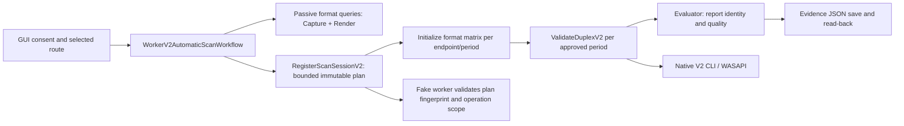

# AS-N4B.2.2 Legacy and V2 Audit

## Audit status

**PASS — audit and implementation contract.** Reviewed at PR #10 HEAD `434a22361e46355b83c20d1374a74c2c57485361`. This documents current behavior and required changes; it does not claim V2 CUSTOM support. Runtime implementation and physical audio tests were not changed/run. Cross-language fingerprint vectors remain a required implementation acceptance gate, not an audit blocker: current canonicalization was statically compared below.

## LEGACY_FUNCTIONALITY_AUDIT

The legacy implementation has separate planning, authorization and execution for discovery, custom duplex, and repeatability. `ExclusivePeriodDiscovery.cs:7-10` formats `CUSTOM:<100ns>:<frames>`; `:43-56` caps generation at eight candidates and uses a default 48 kHz frame conversion. Generator emits selected hard-coded frame counts (192..432) plus quartiles, excludes the endpoints, sorts ascending, and does not accept alignment/format/channel inputs. `:57` fingerprints the serialized discovery DTO with SHA-256; this is a different fingerprint purpose from V2 scan-plan authorization.

`ExclusivePeriodDiscoveryWorkerWorkflow.cs:25-28` authorizes `InitializeExclusiveCustomPeriod` with periods for the fixed 48 kHz PCM16 stereo format, 2 operations per candidate (Capture and Render), 10 s per operation, and `candidateCount*2` maximum operations; lifetime is calculated from count, operation timeout, close wait, and margin. Its run loop executes directions/candidates sequentially, records diagnostics, and stops on unknown/cancel/cleanup uncertainty. `ExclusivePeriodDiscoverySeriesJson` in `ExclusivePeriodDiscovery.cs:60-120` persists up to 16 reports / 1 MiB, validates schema v1 lifecycle (`COMPLETED|UNKNOWN`), provenance and eligibility, writes no-overwrite and reads back.

`CustomPeriodDuplexWorkerWorkflow.cs:10-22,25-73` requires prior discovery evidence for exact endpoints and selected frames, but constructs the same fixed 48 kHz PCM16 stereo V1 format plan and executes one V1 `ValidateDuplex` for 5 seconds. It saves real evidence, leaves synthetic evidence local, and changes cleanup uncertainty to UNKNOWN. `DuplexRepeatabilityWorkerWorkflow.cs:39-68,80-170` has bounded repeatability authorization (normal plan up to coordinator max runs; custom plan explicitly five operations), same fixed format for custom, sequential execution, cancellation as unknown, and close confirmation. It is reusable as a bounded later phase only after V2 route/custom authorization is added.

`WorkerAutomaticScanWorkflow.cs` is the older generic scan route and delegates operation budgeting/execution to `ScanCoordinator`; it is not the new V2 AUTO_SHORT implementation. Native custom Initialize code is `fake_worker.cpp:1029-1080`: parser demands exact value consistency and the native operation queries period bounds, attempts exact Initialize, classifies actual buffer/period/alignment and serializes report; however the worker currently constrains its request to 48 kHz/2ch/PCM16. Native `ParseCustomDuplexPeriod` in `fake_worker.cpp:52-61` also converts/verifies at 48 kHz. `wasapi_endpoint_probe.cpp:4564-4572` limits classic stream/duplex to 48 kHz stereo PCM16. The V2 dispatcher at `:4585-4589` takes route format, but passes only `periodText == minimum` and `std::nullopt` for custom period.

`exclusive_format_matrix.h` and the `--format-matrix` modes provide passive-query and initialize-only format checks; they are not a substitute for actual duplex short validation. `probe_math.h` contains duration bounds (1–30 seconds), sustained duration choices (60/300/600 seconds), and quality classification. The requested eight-candidate cap is explicit in the planner; it should not be silently raised.

## V2_REGRESSION_GAPS

| Capability / gap | Evidence at PR #10 | Impact |
|---|---|---|
| AUTO_SHORT candidate inventory is exactly DEFAULT/MINIMUM | `src/gui/KlidanAudioProbe.Gui.Worker/WorkerV2AutomaticScanWorkflow.cs:21-22,52-70`; `WorkerProtocol.cs:202-210` | Public entrypoint rejects CUSTOM; plan permits at most two DEFAULT/MINIMUM periods |
| Legacy custom candidate list cap | `src/gui/KlidanAudioProbe.Gui.Core/ExclusivePeriodDiscovery.cs:41-46` | Eight candidates may leave unresolved gaps |
| Legacy candidate generation assumes 48 kHz by default | same file, `Generate(... rate = 48_000)` | Frame mapping wrong for other rates unless explicit rate supplied |
| Legacy CLI classic duplex restricted to 48 kHz stereo PCM16 | `src/probe/wasapi_endpoint_probe.cpp:4564-4572` | Not suitable for arbitrary selected V2 route |
| V2 Duplex worker explicitly rejects CUSTOM in route mode | `src/worker/fake_worker.cpp:1275-1288` (`(routeV2 && isCustomPeriodText())`) | Exact custom period cannot reach native V2 Duplex |
| V2 Native CLI drops custom period | `src/probe/wasapi_endpoint_probe.cpp:4585-4589` passes null custom period and boolean minimum selector | Even after worker validation is widened, custom request would be lost |
| Custom Initialize only supports fixed 48k/2ch/PCM16 | `ExclusivePeriodDiscoveryWorkerWorkflow.cs:26-28`; `fake_worker.cpp:1030-1035` | Does not match mono capture / stereo render route formats |
| V2 evidence evaluator does not establish request-to-actual period equality | `V2AutoShortEvaluator.cs:62-74` checks route identity and positive actual frames, but does not compare expected per-side period/frame values | Candidate can be reported CLEAN despite wrong/clamped geometry unless tightened |
| AUTO_SHORT does not repeatability-qualify | `WorkerV2AutomaticScanWorkflow.cs:157-164` | Result is preliminary and `NOT_CERTIFIED`; no profile qualification |

### Verified operation chain

Observed AUTO_SHORT flow at `WorkerV2AutomaticScanWorkflow.cs:52-126`: builds DEFAULT/MINIMUM from passive query; returns without session if neither supported; registers session; sequentially initializes both endpoints per candidate; runs one 5 s duplex for each initialized candidate; records results and stops on UNKNOWN. It then skips repeatability (`:157-159`) and saves local evidence (`:163-166,406-440`). It does not sort the candidates by actual duration before running (DEFAULT then MINIMUM), and evaluator selects MINIMUM preferentially rather than comparing actual durations (`V2AutoShortEvaluator.cs:25-32`). Thus it is not a general smallest-period search.

V2 authorization C# `WorkerProtocol.cs:202-210` fixes SHORT budget `(120s lifetime, 5s operation, 3 ops, 5s total)`, AUTO_SHORT `(180,5,6,10)`, FULL `(1200,600,12,995)`; caps periods at two and only DEFAULT/MINIMUM. Native mirrors these bounds and period allowlist at `fake_worker.cpp:768-779,772-776`; allowed V2 operations are `ValidateFormatMatrix` and `ValidateDuplexV2` (`:780`), with qualification state tracking for ordering (`:846-912`). This establishes the hard block, not merely a missing UI option.

Fingerprint canonicalization (static conformance review): C# `WorkerProtocol.cs:187-210` and native `channel_routing.h:91-108`, `fake_worker.cpp:761-764` were compared. Route canonical fields/order are contract version `2`, capture ID, render ID, route mode, capture format tuple, render tuple, then selected Capture indices `C<n>|` and Render indices `R<n>|`. C# encodes UTF-8 before FNV-1a and native hashes the JSON-decoded UTF-8 bytes; both use FNV offset `14695981039346656037`, prime `1099511628211`, lowercase 16-digit hex. Plan canonical serialization is `SCAN_PLAN_V2|3|<generation>|<qaMode>|<lifetime>|<maxDuration>|<maxOperations>|<maxTotal>|<routeFingerprint>\n`, then sorted ordinal `P|<period>\n`, sorted ordinal `M|<mode>\n`, then numeric sorted `D|<seconds>\n`. C# ordinal order matches native bytewise `std::set` for current ASCII tokens. IDs are represented through route hash, not repeated directly in plan canonical text. `accepted` and `confirmationId` are excluded from hash but validated separately as one-use operator authorization (`WorkerProtocol.cs:202-210`; `fake_worker.cpp:777-779`). No executable cross-runtime vector test exists (`rg` search found no tests for these methods); implementation must add vectors for ASCII and non-ASCII IDs, all route modes, candidate order, budget mutations, and canonical output/hash. This is an acceptance gate for new contract version, not a claim of independently executed runtime parity.

Evidence: `V2AutomaticScanEvidenceStorage.Save` (`WorkerV2AutomaticScanWorkflow.cs:418-440`) writes envelope schemaVersion 1 with result, both passive queries, optional Initialize reports, explicit physical/RTL/audio-host unknown states; no-overwrite, temp-write, read-back hash. Duplex report schema `docs/schemas/wasapi-duplex-validation-v2.schema.json:1-...` requires per-side actualBufferFrames, lifecycle/quality/cleanup and requested route data. It has no aggregate per-candidate matrix contract; V2 result currently serializes candidate assessments in its result object, but no schema validates that aggregate. The evaluator does not verify actual buffer against exact request as noted above.

## REUSE_PLAN

Reuse: current V2 endpoint/route discovery, independent per-side format query, V2 session lifecycle, V2 duplex report and evidence storage; existing native Initialize-only implementation and V2 Duplex mechanics after exposing the exact period argument; `V2AutoShortEvaluator` report identity/clean-quality checks after adding strict geometry comparison; bounded legacy repeatability orchestration after route-aware authorization. Do not transplant legacy candidate scanner wholesale: its current request format is hard-coded 48 kHz stereo and legacy duplex command is V1.

Adapt: candidate planning to use endpoint-specific rates, encodings, channel counts and independently queried bounds; V2 authorization contract in both C# and native to bind exact ordered CUSTOM periods, formats/route, per-stage operation plan and budgets; fake worker to allow V2 custom Initialize and V2 custom Duplex only under that scope; native CLI to accept exact custom period and derive frame duration using each side's actual rate; evaluator to require exact per-side requested/actual frames/period and cleanup; evidence schema to preserve every candidate disposition. GUI consent entry point is `ViewModels.cs:548-568,1667-1670`; it displays the prepared plan and binds route fingerprint, so the preparation must be regenerated and consent invalidated whenever candidate list or budget changes.

## MINIMUM_STABLE_BUFFER_SELECTION

Proposed sequence: `DISCOVERY → CANDIDATES → INITIALIZE → SHORT DUPLEX → MINIMUM CLEAN → PROFILE`.

Discovery queries currently cover selected route sample rate/encoding/channels and query DEFAULT/MINIMUM independently per endpoint (`WorkerV2AutomaticScanWorkflow.cs:43-70`). Candidate planner should merge legal times in duration space, convert separately to frames for each side with native-compatible rounding, and retain separate Capture/Render requested/actual geometry. A shared exact CUSTOM value cannot assume equal frame counts at different sample rates. Run exact Initialize both sides; if either rejects or alignment differs, mark candidate REJECTED/FAILED and do not duplex. Initialize success is eligibility only, never CLEAN. Then run sequential SHORT Duplex; confirmed nonclean with confirmed cleanup is FAILED and search continues; UNKNOWN, cancellation, disconnect or unconfirmed cleanup halts further audio calls. Current evaluator clean requires `DUPLEX_CLEAN`, both side quality CLEAN, cleanup RELEASE_ATTEMPTED, start/stop/duration/frame coverage >=99%, positive frames/buffer and zero selected anomaly counters (`V2AutoShortEvaluator.cs:62-92`); require exact expected-vs-actual geometry additionally.

Keep explicit per-candidate states: REJECTED, FAILED, UNKNOWN, SKIPPED, NOT_TESTED, CLEAN. Smaller untested legal candidates mean “minimum among tested candidates,” never an absolute minimum. Bloody example: 144 and 192 FAILED, 240 and 480 CLEAN selects 240, conditional on no unresolved smaller legal candidate. FLOW 8 example: capture mono/render stereo, 144 and 480 CLEAN selects 144 only if search bounds establish no smaller omitted candidate. These are stipulated test vectors, not measured device outcomes.

Eight candidates do not prove global minimum if lower legal values remain untested. Budget must be computed from actual operations. For `N` candidates: `2N` exact Initialize (one per endpoint) + `N` short Duplex = `3N`; then repeatability for selected candidate uses current custom workflow's five Duplex operations. Total `3N+5`. Existing V2 AUTO_SHORT authorizes six operations and ten active seconds, enough only for its current 2 candidates at three operations each and no repeatability. Existing V2 SHORT allows 3 operations/5 seconds, insufficient for a two-endpoint Initialize plus Duplex. Passive format queries are separate commands and not counted as authorized audio operations in the V2 plan. Each Initialize is bounded by its own operation timeout; planned active audio time is `5N + 5R` seconds if SHORT duration remains 5s and repeatability uses R runs, exclusive of Initialize calls (which still consume operation-count/session wall-clock). Do not assign N or R until native initialize timeouts and target repeatability policy are approved. An adaptive refinement must register a fresh plan and operator consent; no silent budget growth. Current legacy discovery caps `N=8`; a complete exhaustive grid across `[min,default]` is not implied by eight samples. Recommendation must say “smallest verified tested candidate”; global minimum is proven only if every smaller legal candidate in the declared search domain was tested or authoritatively rejected.

### Proposed contract and compatibility work

| Area | Change to plan | Reason | PR #3–#10 compatibility risk |
|---|---|---|---|
| JSON schema | Add candidate matrix, disposition, exact requested/actual per-direction period and buffer, route/format identity, termination reason; version schema | Preserve complete evidence and distinguish unknown from failure | Strict v1/v2 consumers may reject new required fields; use additive optional fields or a new schema version |
| Worker authorization | Bind endpoint/route fingerprint, exact CUSTOM set, formats, operation counts, stage ordering and duration/session bounds; expansion requires renewed consent | Prevent widening consent and enforce stage order | Version contract; preserve V1 and existing V2 DEFAULT/MINIMUM hashes/semantics |
| Native CLI | Add exact custom duration and independent per-side requested frame calculation/actual geometry checks | Current route V2 call discards period and parser rejects custom | Keep old invocations unchanged; report schema versioning needed |
| GUI coordinator | Show bounded plan and outcomes; stop on UNKNOWN; request renewed consent for adaptive expansion | Consent must match work actually executed | Existing confirmation IDs/plan hashes may need migration |
| Evaluator/tests | Evaluate full state matrix, no monotonic assumptions, fingerprint parity, all abort cases | Correct minimum claim and safe stop behavior | Golden reports and fake-worker fixtures may rely on old enum/schema set |

### Test matrix (synthetic contract cases only; not physical measurements)

| Scenario | Candidate outcomes | Expected result / stop |
|---|---|---|
| Bloody, 48k PCM16 2ch | 3ms fail; 4ms fail; 5ms clean; 10ms clean | recommend 5ms; repeatability only at 5ms |
| FLOW 8, capture 1ch/render 2ch, 48k PCM16 | 3ms clean; 10ms clean | recommend 3ms only if no smaller legal untested candidate exists |
| No CLEAN candidates | all supported candidates FAILED | NO_RECOMMENDATION; preserve matrix |
| UNKNOWN mid-search | earlier terminal results; next candidate not attempted | stop; no recommendation unless policy explicitly permits preserving preliminary candidate (recommendation should be null) |
| Initialize succeeds, Duplex non-CLEAN | Initialize eligible; Duplex FAILED | continue to next candidate; never classify CLEAN |
| CUSTOM unsupported / alignment mismatch | per-side reject or geometry mismatch | candidate REJECTED/FAILED; no Duplex |
| Different actual Capture/Render sizes | any side differs from request or route-derived expected frames | UNKNOWN or FAILED per reliable native outcome; never CLEAN |
| Smaller period NOT_TESTED | larger candidate CLEAN | smallest tested recommendation; `globalMinimumProven=false` |
| cancellation/disconnect/budget/fingerprint/cleanup error | any in-flight/next candidate state | stop; classify unresolved operation UNKNOWN; no more audio I/O |

These are project-provided synthetic expectations, not device observations.

### Implementation stages and acceptance

1. **Contract proposal/tests:** define candidate representation with separate per-side frames/periods; status matrix; test vectors; budget derivation. Accept only if no runtime change and C#/C++ canonical vectors agree.
2. **Authorization:** versioned V2 plan includes exact candidates, route, format, order, operation cap and wall/active limits; native rejects any omitted/reordered/over-budget operation. Preserve old V2 contracts.
3. **CUSTOM transport:** worker and CLI carry CUSTOM intact; exact initialize reports requested and actual Capture/Render geometry; route-specific format values used throughout.
4. **Search orchestration/evaluator:** sequential candidate iteration; stop UNKNOWN; nonmonotonic results retained; choose min CLEAN by actual duration; full matrix persisted; no implicit untested-minimum claim.
5. **Repeatability/profile:** run bounded repeatability only for selected candidate; profile only if repeatability passes and evidence saved/read back; no sustained/mass repeats per candidate.

Acceptance: Bloody synthetic selection 5ms; FLOW 8 synthetic selection 3ms conditional on search floor; initialize-only never yields recommendation; UNKNOWN halts; cancellation/device invalidation leaves subsequent candidates NOT_TESTED; all candidate statuses round-trip through saved report; route/fingerprint mismatch rejected on both sides; no unconsented budget expansion; repeatability only runs selected candidate; no physical result fabricated.

Open decisions: search domain granularity (all aligned legal periods vs bounded adaptive sample), initialize-only and session wall-time bounds, repeatability run count and duration, treatment of UNKNOWN after earlier CLEAN (recommended: no final recommendation), and whether confirmed FAILED candidates remain eligible to recommend a larger passing candidate (yes, but only “smallest tested”).

## Next audit steps

Current GUI consent reviewed at `ViewModels.cs:542-556`, `UiResources.resx:1273,1349`, and Russian resources at the same lines: it shows Capture/Render IDs, route, channels, rate/encoding, period, route fingerprint, QA mode, max ops, active seconds and session seconds; AUTO_SHORT text says two five-second Duplex runs. It does not yet show a bounded eight-candidate plan or repeatability count. New consent must enumerate candidate count/domain, `3N+R` audio operations, `5(N+R)` active Duplex seconds, Initialize timeout, session lifetime, cleanup deadline and R, and fingerprint the exact ordered plan. Any plan/budget change invalidates consent; no extension in-place.

Audit gates are closed as documentation tasks: the plan explicitly lists required implementation acceptance gates (fingerprint vectors, aggregate schema validation and native CUSTOM route support). Those are not assertions that these features currently exist. PR #11 was not modified.

## Final implementation contract

### Candidate domain and order

Let endpoint-native minimum/maximum periods define the intersection duration interval. At 48 kHz, for the declared 3–10 ms project search domain, the ordered frame grid is exactly `144,192,240,288,336,384,432,480` (3–10 ms inclusive). At other rates, construct at most eight unique frame candidates by inclusive integer interpolation between each side's native bounds, then retain shared duration candidates that convert to legal frame requests for both sides using `round(duration100ns * rate / 10,000,000)`; deduplicate and sort by exact duration, then Capture/Render frames as deterministic tie-breakers. A candidate violating known supported-frame/alignment constraints is retained as REJECTED with the constraint reason, not silently erased. Native exact Initialize is authoritative for support; the actual frames and period from each side must equal that side's request. Candidate domain and any smaller excluded-by-domain interval are recorded in consent and evidence. Search candidates sequentially ascending; stop short probing at first CLEAN only after all smaller candidates in this declared domain have terminal REJECTED/FAILED/CLEAN outcomes. Stability is not assumed monotone. Larger candidates then remain NOT_TESTED/SKIPPED with explicit reason. “Minimum” means minimum CLEAN in the authorized domain; no global claim outside it.

### Derived budgets and current counter semantics

`N≤8`, `R≤5`; maximum audio operation count is `3N+R = 29` (16 Initialize + 8 candidate Duplex + 5 selected-candidate repeatability Duplex). Current V2 fake worker increments `session->used` for both `ValidateFormatMatrix` Initialize calls (`AuthorizeScanOperation`, `fake_worker.cpp:833-844`) and `ValidateDuplexV2` (`:854-870`); each is an operation. It accumulates `usedTotalDuration` only for Duplex duration (`:856,870`), so Initialize calls count toward operation cap but not active-duration counter. Passive `QueryFormatMatrix` calls at workflow `:45-46` occur outside registered V2 session and are not audio operations; they are separately bounded worker requests and not counted in `used`.

| Limit | Contract at N=8, R=5 | Derivation / current behavior |
|---|---:|---|
| Audio operations | 29 | `3N+R`; currently V2 AUTO_SHORT hard-capped at 6, so contract requires new plan version |
| Active Duplex duration | 65 s | `(N+R)*5`; current `usedTotalDuration` counts Duplex only; 5s candidate SHORT and five 5s repeatability runs |
| Initialize IPC deadlines | 16 × 30 s = 480 s maximum | `ValidateFormatMatrix` timeout is 30 s (`NativeWorkerClient.cs:678`); one Initialize per endpoint per candidate |
| Duplex IPC response envelope | 13 × 51 s = 663 s maximum | 5s requested operation, but client uses global max 10s + 25s child slack + 3s graceful + 3s forced + 10s report/setup = 51s (`NativeWorkerClient.cs:18-25,675`) |
| Session wall-clock lifetime | 1,171 s maximum | Conservative serial bound `480 + 663 + 8s Close + 20s safety`; session expiry uses this wall lifetime (`fake_worker.cpp:782`) |
| Cleanup deadline | 8 s | Current `SessionCloseTimeoutSeconds=8` (`NativeWorkerClient.cs:23,679`); apply per session-close attempt and stop on UNKNOWN |

For smaller N/R derive: `ops=3N+R`, `active=5(N+R)`, `initTimeout=60N`, `duplexResponseBound=51(N+R)`, `sessionWall=111N+51R+28` seconds. This is a conservative client deadline envelope, not expected runtime. The worker's `maximumOperationDurationSeconds` currently also constrains operation duration but generic Initialize passes duration 0; the new plan must define separate Initialize IPC timeout and active Duplex cap rather than conflating them. Native V2 contract currently rejects any budgets except fixed mode tuples (`WorkerProtocol.cs:204-205`; `fake_worker.cpp:769`), so both ends require versioned validation. One authorized session must bind N, R, exact sequence and these computed maxima before consent.

### Consent contract

Preserve current exact endpoints and route format fields shown by the existing GUI, adding: ordered candidate domain (including per-side rates/channels/encoding and frame conversions), number of candidates, max audio operation count, max active Duplex seconds, max Initialize IPC deadline and count, worst-case session wall clock, cleanup deadline, repeatability count and the fact that repeats apply only to selected candidate. Fingerprint all these fields. Consent is immutable: any candidate, route, count, duration, or time-limit change cancels the prepared consent and requires fresh operator acceptance. This extends—not silently increases—the current V2 consent summary.

### Versioned evidence and selection

Write a new aggregate `v2-auto-short-candidate-matrix` schema version; keep old V2 report schema readers intact. Required envelope: schema version, plan/route fingerprints, candidate domain, budget, lifecycle, candidate array, selection state, timestamps and provenance. Each candidate carries requested duration and per-side frames; actual Capture/Render duration and frames; per-side Initialize status/disposition and cleanup; Duplex status/disposition; reason codes; `duplexNotRun` boolean and skip reason; and lower-period coverage (`smallerCandidates` terminal list plus `smallerUntestedCount`/domain bounds). Enum states include `REJECTED`, `FAILED`, `UNSUPPORTED`, `UNKNOWN`, `CLEAN`, `SKIPPED`, `NOT_TESTED`. Missing/malformed evidence is UNKNOWN, not failure.

Selection states: `MINIMUM_SHORT_CLEAN_FOUND` means all smaller candidates in domain are terminal and this is the first CLEAN; `REPEATABILITY_CONFIRMED` only after bounded repeatability passes for this selected candidate; `REPEATABILITY_FAILED` means no stable profile may be emitted; `MINIMUM_NOT_PROVEN` when smaller candidates remain unresolved/not tested; `UNKNOWN` when in-flight outcome, cleanup, cancellation or device state is unresolved. Profile output requires `REPEATABILITY_CONFIRMED`; short CLEAN alone is provisional. No automatic fallback to a larger CLEAN after repeatability failure under this budget.

## Consolidated evidence matrix

| File / function | Existing behavior | Gap | Required change | Evidence |
|---|---|---|---|---|
| `ExclusivePeriodDiscovery.cs` / `Planning.Generate`, `SeriesJson` | CUSTOM text, eight frame candidates; series evidence bounded to 16 reports/1 MiB | Fixed default 48 kHz and no per-side alignment | Parameterize route format/bounds; keep bounded candidate generation; version series matrix | `:7-10,43-56,60-120` |
| `ExclusivePeriodDiscoveryWorkerWorkflow.cs` / prepare+run | Per candidate Capture/Render exact Initialize, sequential; 10s op timeout | V1 fixed 48k PCM16 stereo scope | Reuse mechanics only after route-aware format plan | `:25-28,54+` |
| `exclusive_period_discovery.h` / `Classify`, `ToJson` | Checks actual period and frames against request, alignment; emits per-attempt evidence | Existing worker command binds only 48k stereo and does not integrate V2 route | Reuse classification; expose through V2-bound operation | `:83-100,160-190` |
| `CustomPeriodDuplexWorkerWorkflow.cs` / `Prepare`, `RunApprovedAsync` | One authorized V1 custom Duplex, 5s, cleanup-aware persistence | Fixed format and V1 command | Do not duplicate; route-aware V2 call needed | `:10-22,25-73` |
| `DuplexRepeatabilityWorkerWorkflow.cs` / `PrepareCustom`, `RunApprovedCoreAsync` | Bounded five-run custom repeatability; sequential and cleanup-aware | Hard-coded custom format, not connected to V2 AUTO_SHORT | Reuse post-selection with exact route/custom plan | `:48-68,80-170` |
| `WorkerAutomaticScanWorkflow.cs` | Legacy generic stages through ScanCoordinator | Not V2 candidate discovery | Do not port wholesale; keep existing coordinator patterns | workflow file; coordinator `ScanCoordinator.cs:187-220` |
| `WorkerV2AutomaticScanWorkflow.cs` / AUTO_SHORT branch | Two query candidates; per-candidate two Initialize then 5s duplex; stop at UNKNOWN | Only DEFAULT/MINIMUM; DEFAULT then MINIMUM execution; skips repeatability | Replace inventory with explicitly approved candidate list and sequenced phases | `:17-22,52-126,157-166` |
| `V2AutoShortEvaluator.cs` / Evaluate, ClassifyReport | Validates report identity/quality and cleanup; selects MINIMUM before DEFAULT | No requested-vs-actual geometry equality; tie-break ignores actual duration | Compare exact per-side requested/actual period and frames; select true smallest eligible CLEAN | `:23-33,35-95` |
| `WorkerProtocol.cs` / `WorkerScanPlanV2Fingerprint.Compute` | Immutable contract v3, mode-specific caps, periods max 2 and enum DEFAULT/MINIMUM | Cannot authorize CUSTOM or larger candidate matrix | Versioned plan binds every candidate, sequence and computed budget | `:185-215` |
| `NativeWorkerClient.cs` / V2 methods | Registers plan and routes bounded V2 commands; V2 duplex accepts only DEFAULT/MINIMUM | Rejects CUSTOM at client boundary; V1 custom init fixed 48k/2ch | Add versioned V2 CUSTOM transport; preserve existing method behavior | `:218-221,271-277,388-398` |
| `fake_worker.cpp` / ParseScanAuthorizationV2, AuthorizeV2ScanOperation | Verifies SHA plan, max 6 AUTO_SHORT operations, and exact DEFAULT/MINIMUM Initialize/duplex order | V2 scope and sequence exclude CUSTOM; current order logic assumes 3 ops per period | Mirror new contract exactly and enforce per-candidate Initialize→Duplex order, limits and stop state | `:761-780,840-860` |
| `fake_worker.cpp` / custom period and duplex dispatch | V1 custom Initialize exact parsing; V1 custom duplex parser at 48k | V2 explicitly rejects custom period | Add route-dependent parsing/authorization and per-side frame derivation | `:52-61,1029-1080,1270-1288` |
| `wasapi_endpoint_probe.cpp` / V2 dispatch | V2 route forwards selected side formats into native duplex | Calls `RunDuplex` with custom period `nullopt`; custom value is lost | Add exact period request to V2 native dispatch and report requested/actual geometry | `:4585-4589` |
| `wasapi-duplex-validation-v2.schema.json` | Strict report schema; period enum DEFAULT/MINIMUM, 48k PCM16 stereo; per-side actual buffer required | Does not admit custom route evidence or candidate result matrix; schema const v2 differs route report's v3 | New schema version for route CUSTOM and aggregate full candidate state matrix | `:5-25,27-42,46-71` |
| `V2AutomaticScanEvidenceStorage.Save` | No-overwrite save, temp-file atomic move, hash/readback; includes queries and initialize evidence | No separate schema validation for aggregate candidate matrix | Add versioned schema validation and require every candidate disposition | `WorkerV2AutomaticScanWorkflow.cs:406-440` |

**Native CLI custom V2 review: BLOCKED for support; confirmed unsupported in the current path.** Worker rejects route V2 CUSTOM (`fake_worker.cpp:1281`); independently, CLI V2 call passes `nullopt` (`wasapi_endpoint_probe.cpp:4589`). Native custom Initialize is currently a legacy worker operation, fixed to 48 kHz PCM16 stereo (`NativeWorkerClient.cs:271-277`, `fake_worker.cpp:1030-1035`).

**Evidence schema review: BLOCKED for a complete aggregate contract.** The current standalone duplex v2 schema is strict, disallows extra properties, fixes requested format and period enum (`docs/schemas/wasapi-duplex-validation-v2.schema.json:5-25`), while route V2 reports use schemaVersion 3 in the evaluator (`V2AutoShortEvaluator.cs:49-59`). A new route-CUSTOM candidate-matrix schema/version is needed; backward compatibility requires keeping existing schemas readable and writing a new explicit version.
